# GLF OS Welcome Screen

Welcome screen for [GLF OS](https://github.com/Gaming-Linux-FR/GLF-OS) (a Linux distribution based on NixOS) that introduces the main features of the system and launches its in-house tools.

Built with Python, GTK4 and Libadwaita. Available in English and French.

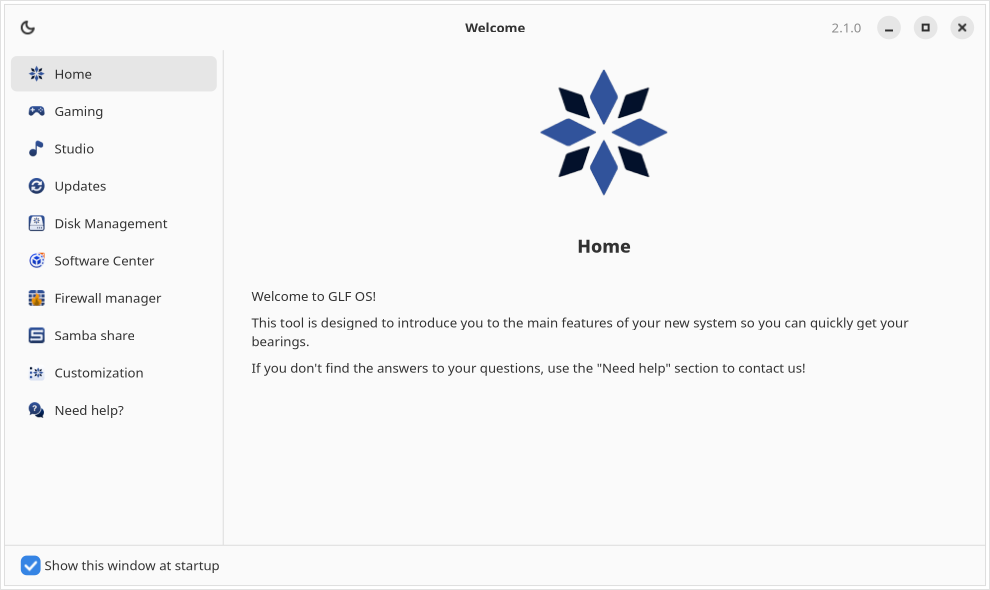

## Features

- **Guided tour**: one page per feature of GLF OS, listed in a sidebar
  - Home, Gaming, Studio edition, Updates and Help (useful links)
- **Tool launcher**: on each tool page, click the image to open the corresponding application
  - Nix Disk: mount secondary drives (run with `pkexec`)
  - EasyFlatpak: Flatpak software center
  - Nix Firewall Manager: manage firewall rules (run with `pkexec`)
  - Nix Samba: manage Samba shares (run with `pkexec`)
  - GLF Customizer: change edition, software groups, desktop and channel
- **Light and dark theme**: toggle from the header bar, images adapt to the theme
- **Autostart**: the "Show this window at startup" checkbox controls whether the welcome screen opens at login

## Screenshots

### Discover GLF OS

| Gaming | Studio |
| --- | --- |
| 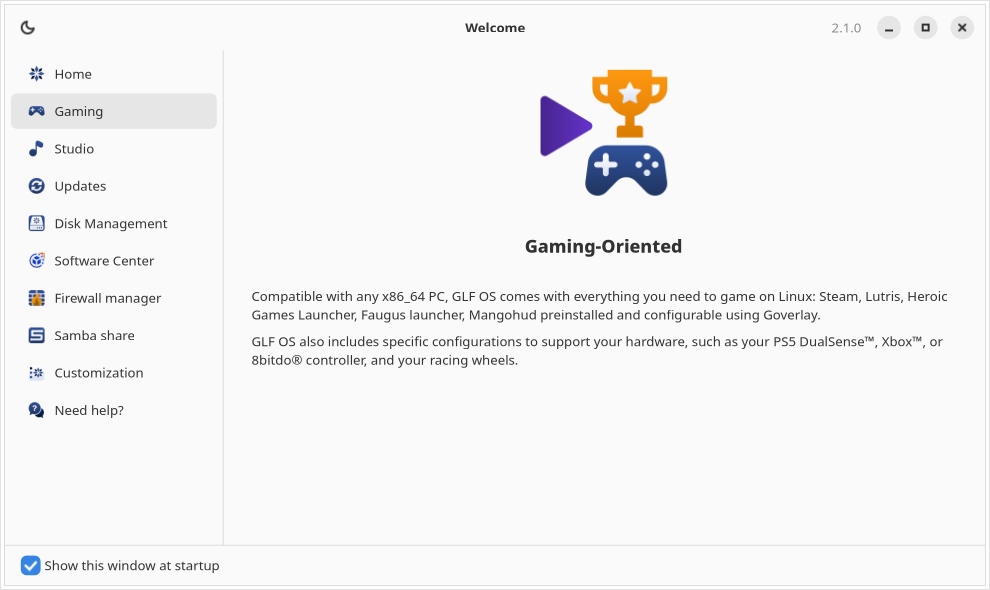 | 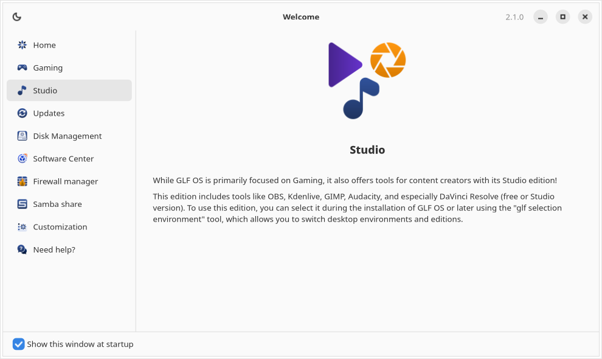 |

| Updates | Need help? |
| --- | --- |
| 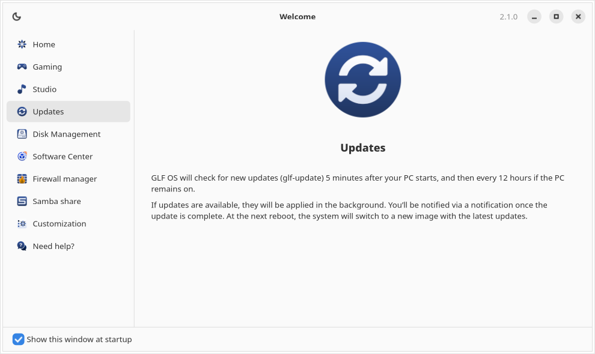 | 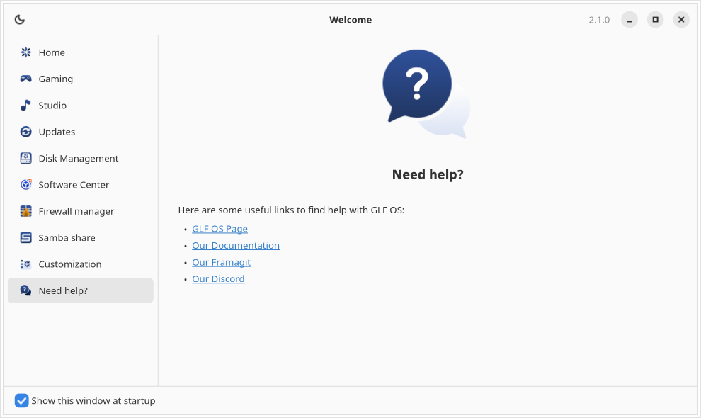 |

### GLF OS tools

| Disk Management | Software Center |
| --- | --- |
| 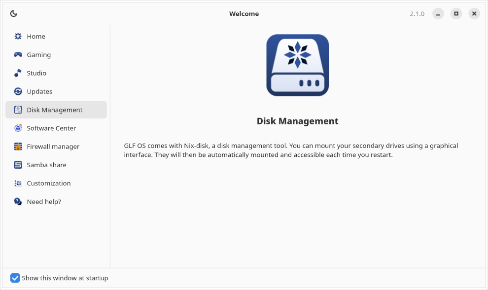 | 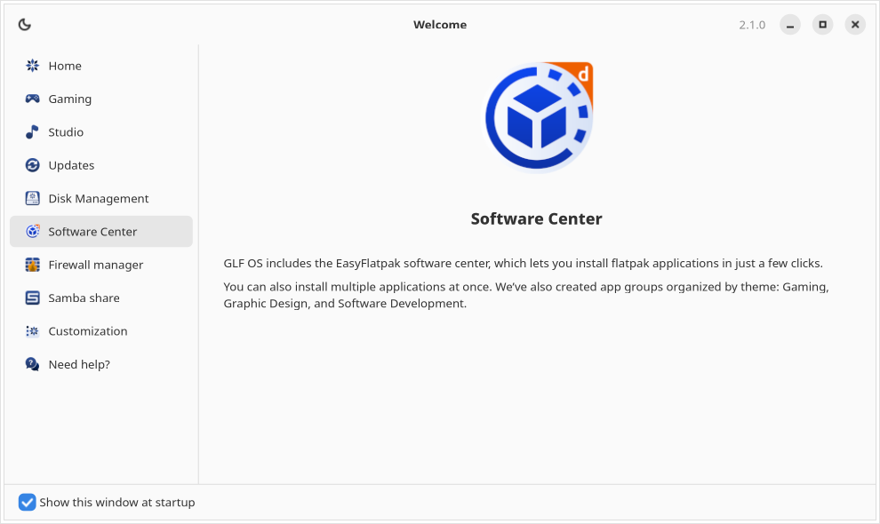 |

| Firewall manager | Samba share |
| --- | --- |
| 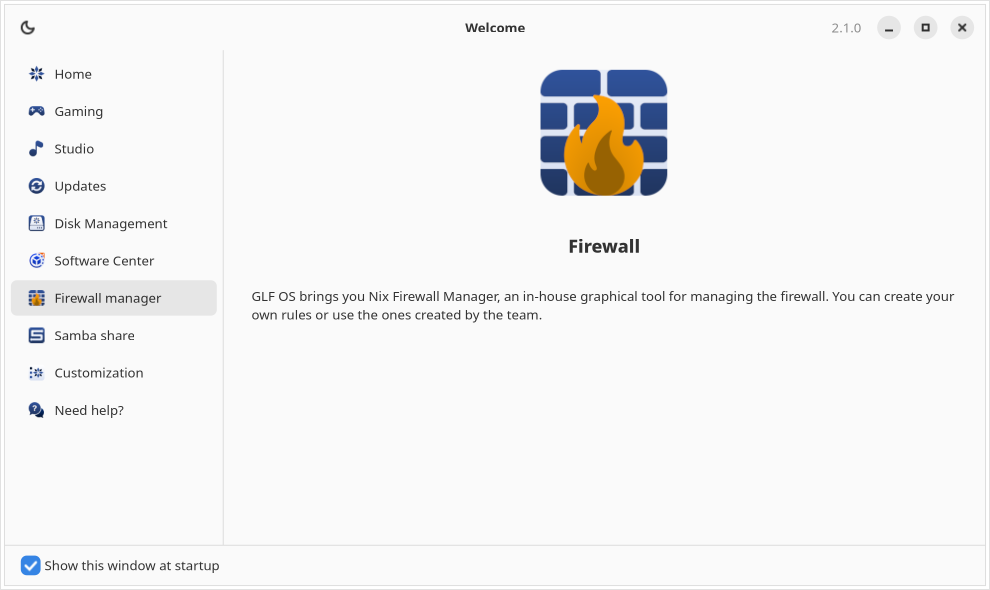 | 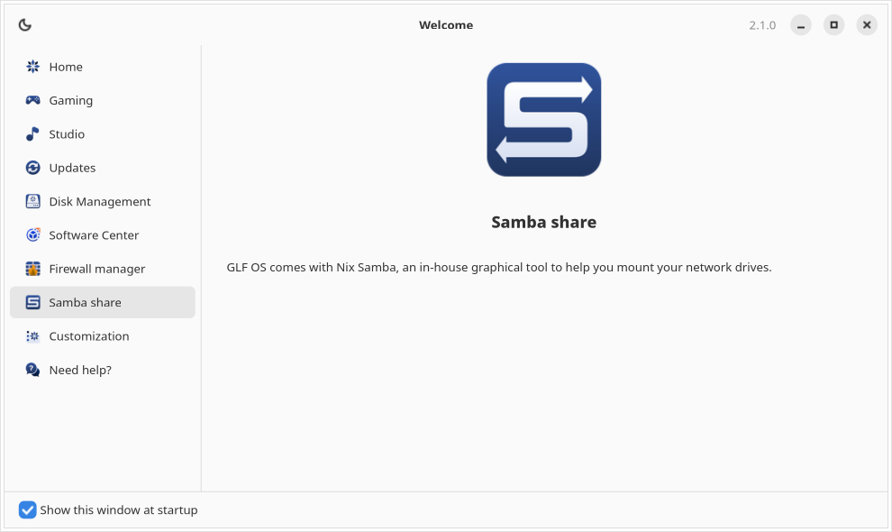 |

| Customization | Dark theme |
| --- | --- |
| 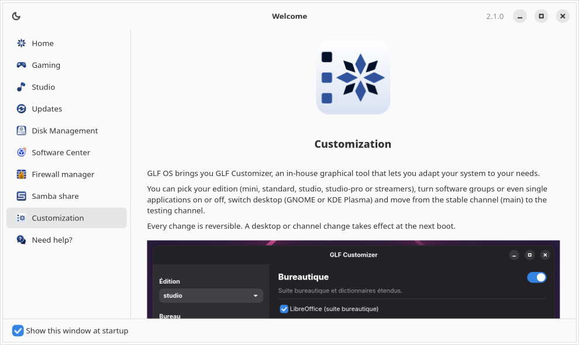 | 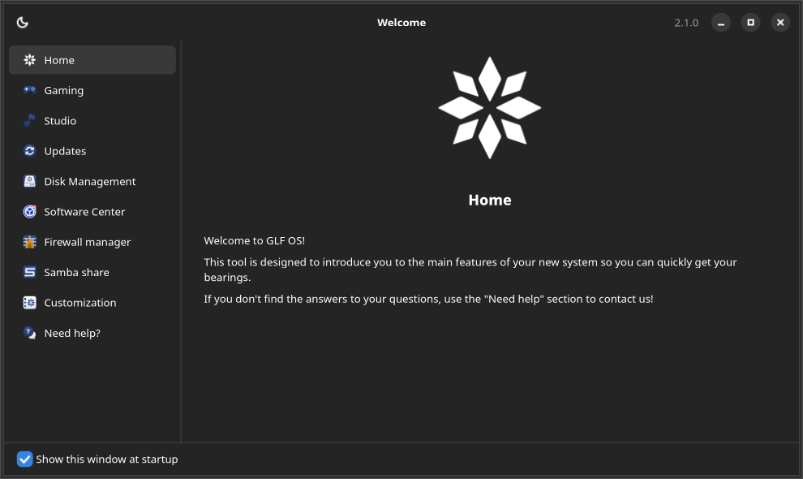 |

## How it works

Pages are declared in `src/config.py` (`PAGES`). Each page has:

- a title and a menu label, translated through `src/assets/en.po` and `src/assets/fr.po`
- a body written in Markdown in `src/assets/localizations/markdowns/<locale>/page_<id>_body.md`
- an image and a menu icon from `src/assets/images/` (with optional `_dark` variants)
- an optional command, run by `src/infrastructure/api/launcher.py` when the page image is clicked:
  - `flatpak://<app-id>`: `flatpak run <app-id>`
  - `bash://<command>`: runs the command in a login shell
  - `bashWithPrivilege://<command>`: runs the command with `pkexec`
  - `http://` or `https://`: opens the URL in the default browser

The language is detected from `LANG` (French for `fr_*`, English otherwise).

Unchecking "Show this window at startup" writes a hidden desktop entry to `~/.config/autostart/glfos-welcome-screen.desktop`. Checking it again removes the file.

## Development

### On Linux with Nix

```bash
nix develop
python src/main.py
```

To force a language:

```bash
python src/main.py --lang=fr_FR
```

### Localization

- UI strings: `src/assets/en.po` and `src/assets/fr.po`
- Page bodies: `src/assets/localizations/markdowns/en_US/` and `src/assets/localizations/markdowns/fr_FR/`

If a Markdown file is missing for the current locale, the `en_US` version is used.

## Release for GLF OS

The version is set in `src/version.py`. After tagging the release on GitHub, update the version and sha256 in `assets/glf/pkgs/default.nix`:

```bash
python update_nix_version.py
```

To only generate the sha256:

```bash
./getGlfSha256.sh X.Y.Z
```

## License

See [LICENSE](LICENSE).
